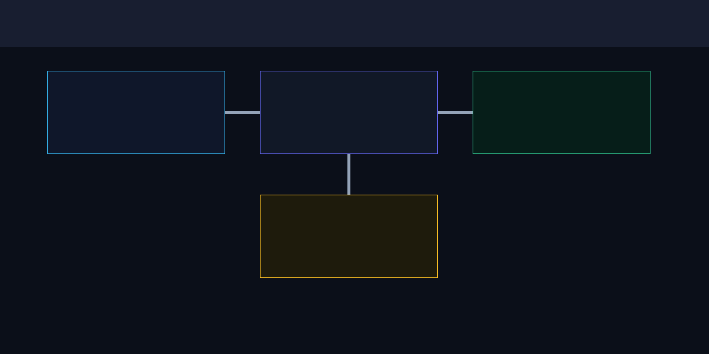

# 🚀 Samarthya AI (Saksham)

> **Inclusive AI-Powered Welfare Delivery & Alternative Credit Readiness Platform for Underserved Citizens.**

- **Live Demo:** [https://samarthya-ai.vercel.app](https://samarthya-ai.vercel.app)
- **Video Pitch / Walkthrough:** [https://youtu.be/your-demo-video](https://youtu.be/your-demo-video)
- **API Documentation:** [http://localhost:8000/docs](http://localhost:8000/docs)

---

## 🎯 Problem & Solution

### Problem
- Over 70% of eligible rural citizens, artisans, and smallholder farmers miss out on entitled government welfare schemes due to complex bureaucratic criteria and language barriers.
- Informal nano-entrepreneurs and gig workers lack formal credit bureau scores (CIBIL), locking them out of institutional concessional credit.
- Citizens face fragmented portals with no unified, voice-assisted digital interface.

### Solution
- **Zero-Hallucination Welfare Matching:** Deterministic rule engine parsing socio-economic indicators across 28+ central and state schemes.
- **Alternative Credit Readiness Index:** Transparent 300–900 scoring model based on cashflow discipline and utility history without invasive data tracking.
- **Conversational Voice Assistant:** Multilingual assistance in 6 Indian languages powered by Google Gemini 1.5 Flash and Wispr Flow.

---

## 🏗️ System Architecture



```
[ Frontend: Next.js 14 App Router (Port 3000) ]
                      │
                      ▼ (REST API / JSON)
[ Backend: FastAPI Modular Gateway (Port 8000) ]
         │                              │
         ▼                              ▼
[ Scheme Evaluation Engine ]   [ Credit Readiness Engine ]
```

---

## 💻 Tech Stack

- **Frontend:** Next.js 14 (App Router), TypeScript, Tailwind CSS
- **Backend:** Python 3.11+, FastAPI, Pydantic Settings, Uvicorn
- **AI & Reasoning:** Google Gemini 1.5 Flash / Pro, Wispr Flow Voice STT
- **DevOps:** Docker, Docker Compose, GitHub Actions CI/CD

---

## ⚡ 3-Step Quickstart

### Step 1: Clone Repository
```bash
git clone https://github.com/AmanKumar731/Samarthya_full-proto.git
cd Samarthya_AI
```

### Step 2: Environment Setup
```bash
cp backend/.env.example backend/.env
cp frontend/.env.example frontend/.env.local
```

### Step 3: Run Locally or via Docker

**Option A: Using Docker Compose (Full Stack)**
```bash
docker compose up --build
```
- Frontend: `http://localhost:3000`
- Backend API Docs: `http://localhost:8000/docs`

**Option B: Running Locally**
```bash
# Terminal 1 - Backend
cd backend
python3 -m venv .venv && source .venv/bin/activate
pip install -r requirements.txt
uvicorn app.main:app --host 0.0.0.0 --port 8000 --reload

# Terminal 2 - Frontend
cd frontend
npm install
npm run dev
```

---

## 🧪 Testing & Verification

```bash
# Run backend pytest suite
cd backend
pytest -v

# Seed sample mock data
python3 ../scripts/seed_db.py
```

---

## 📄 License
MIT License. See [LICENSE](LICENSE) for details.
