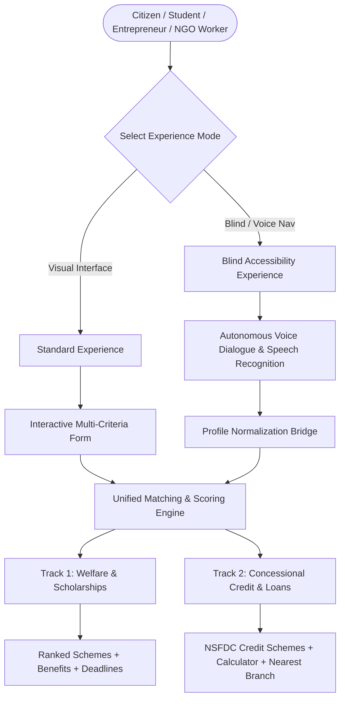
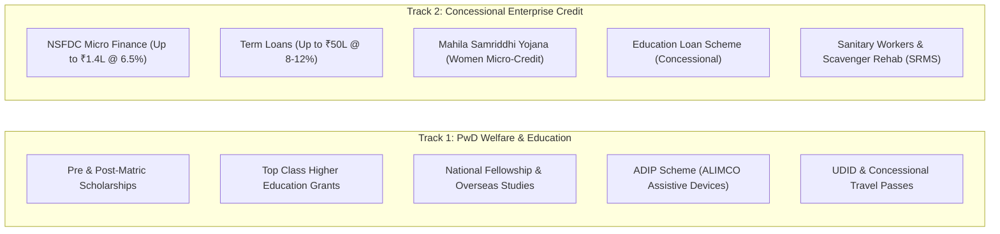
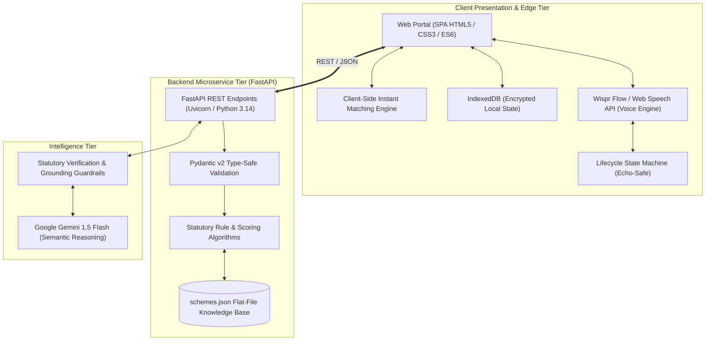
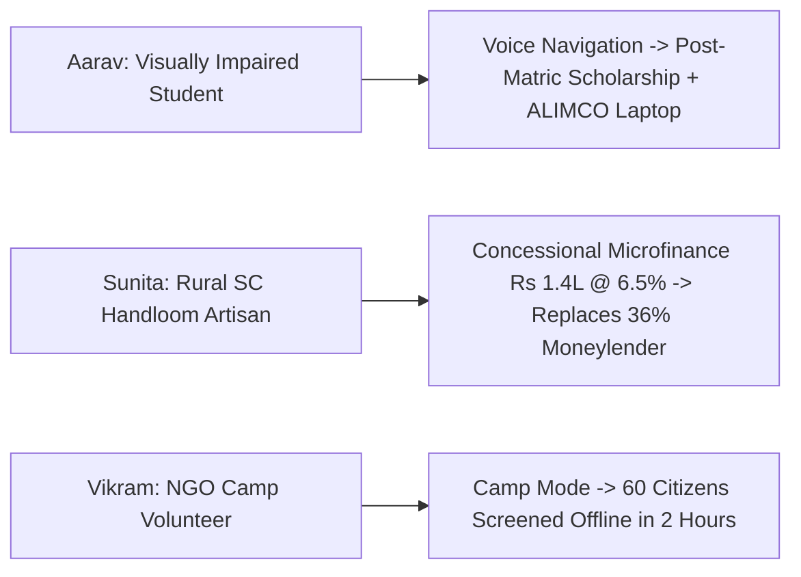
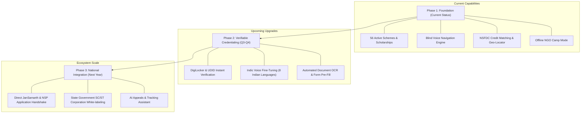

# 🇮🇳 Samarthya AI (Saksham) — Master Project & Idea Documentation

> **"Every citizen deserves to know what they are entitled to — without barriers of sight, language, literacy, or bureaucratic complexity."**

---

## 1. Executive Summary

**Samarthya AI** (operating under the citizen-facing portal **Saksham**) is an AI-powered, inclusive Digital Public Infrastructure (DPI) platform engineered to solve India's last-mile welfare delivery and concessional credit gap.

While the Government of India and various State administrations allocate over **₹3.5 Lakh Crore annually** toward scholarships, assistive devices, social safety nets, and concessional loans, an estimated **60% to 70% of eligible beneficiaries** — particularly Persons with Disabilities (PwD), Scheduled Caste (SC) entrepreneurs, and rural students — remain excluded due to information fragmentation, inaccessible digital interfaces, and daunting procedural bureaucracy.

Samarthya AI bridges this divide through:
1. **Intelligent Welfare Matching**: A deterministic, multi-criteria scoring engine covering 56+ verified central and state schemes.
2. **Dual Experience Paradigm**: A seamless toggle between a visual **Standard Experience** and a groundbreaking, voice-first **Blind Accessibility Experience** with autonomous voice guidance, conversational form intake, and echo-protected speech recognition.
3. **Concessional Credit Enablement (Track 2 / SIH26093)**: Concessional finance mobilization via National Scheduled Castes Finance and Development Corporation (NSFDC), replacing predatory 24%–36% unorganized loans with 6.5%–12% statutory capital.
4. **Grassroots Last-Mile Tools**: Offline-first **NGO/DIC Camp Mode**, an interactive **Financial & Moratorium Calculator**, and a **Channel Partner Geo-Locator** filtering out high-NPA institutions.

---

## 2. The Problem Space (The Last-Mile Divide)

India is home to over **2.68 Crore Persons with Disabilities (Census)** and tens of millions of marginalized socio-economic micro-entrepreneurs. Despite progressive legislation like the *Rights of Persons with Disabilities (RPwD) Act 2016* and massive statutory financial allocations, citizens face systemic roadblocks:

```
┌────────────────────────────────────────────────────────────────────────┐
│                   The Welfare & Credit Exclusion Funnel                │
├────────────────────────────────┬───────────────────────────────────────┤
│ 1. Information Fragmentation   │ Dispersed across 50+ central & state  │
│                                │ portals with zero unified search.     │
├────────────────────────────────┼───────────────────────────────────────┤
│ 2. Bureaucratic Jargon         │ Complex guidelines (e.g. 40% benchmark│
│                                │ disability, income slabs, moratorium).│
├────────────────────────────────┼───────────────────────────────────────┤
│ 3. Digital Accessibility Gap   │ Visually impaired citizens cannot use │
│                                │ mouse-driven UIs or dynamic forms.    │
├────────────────────────────────┼───────────────────────────────────────┤
│ 4. Predatory Informal Credit   │ Marginalized entrepreneurs pay 24-40% │
│                                │ to moneylenders due to bank friction. │
└────────────────────────────────┴───────────────────────────────────────┘
```

### Specific Structural Gaps:
- **Severe Inaccessibility for Visually Impaired Users**: Most government portals rely on CAPTCHAs, poorly labeled ARIA tags, and complex multi-page forms that screen readers struggle to parse. Blind citizens are forced to depend entirely on third-party intermediaries, risking identity fraud and financial exploitation.
- **Cognitive & Eligibility Overload**: A rural student with 50% locomotor disability might qualify for a pre-matric scholarship, ALIMCO assistive tricycles, an Indian Railways concession card, and state-specific maintenance stipends, but typically only discovers one by chance or none at all.
- **Predatory Debt Traps for SC Entrepreneurs**: When an artisan or small shopkeeper needs ₹1 Lakh to ₹5 Lakh for equipment or working capital, commercial banks demand collateral or reject applications. Meanwhile, NSFDC's 6.5%–9% concessional loan schemes remain heavily underutilized because channel partner branches (SCAs, RRBs) lack an accessible customer onboarding funnel.

---

## 3. The Proposed Solution: Samarthya AI (Saksham)

Samarthya AI transforms welfare discovery from a passive, confusing search into an **active, guided, and empathetic intelligence platform**.



---

## 4. Architectural Highlights & Core Pillars

### 4.1. The Dual-Experience Architecture

Samarthya AI provides two purpose-built interaction modes without fracturing the underlying codebase:

#### A. Standard Experience
- **Audience**: Students, family members, social workers, and sighted citizens.
- **Interface**: High-performance, modern responsive interface featuring ambient glow aesthetics, accessible typography, dynamic filter chips, and instant client-side execution.
- **Functionality**: Full access to multi-criteria search, scheme comparisons, PDF/CSV export, and interactive loan simulators.

#### B. Blind Accessibility Experience (Voice-First Autonomous Navigation)
- **Audience**: Blind, visually impaired, and severely motor-impaired individuals.
- **Mechanism**: A zero-mouse, zero-screen-dependency conversational voice assistant.
- **Features**:
  - **Spoken Instructions**: Guides the user through intake questions verbally.
  - **Echo-Protected Audio Lifecycle**: Shuts off microphone input during text-to-speech (TTS) output to avoid capturing its own voice.
  - **Conversational State Machine**: Strict separation across `IDLE`, `LISTENING`, `PROCESSING`, `SPEAKING`, and `WAITING_FOR_CONFIRMATION` states.
  - **Automatic Normalization**: Converts verbal responses (e.g., *"forty percent disability"*, *"Delhi state"*, *"two lakh income"*) into structured data models.
  - **Verbal Results Summary**: Reads aloud eligible schemes, grant amounts, and deadlines upon completion.

---

### 4.2. Dual Policy Tracks



---

### 4.3. Feature Matrix

| Feature Module | Technology / Implementation | Value Provided |
| :--- | :--- | :--- |
| **Deterministic Welfare Matcher** | `js/matcher.js` & FastAPI `/api/match` | Multi-criteria scoring (0–100%) against age, income ceiling, state domicile, disability category, and severity. |
| **Credit Matcher (SIH26093)** | `js/credit-matcher.js` & FastAPI `/api/match-credit` | 5-checkpoint statutory evaluation checking caste certification, income ($\le$ ₹5.0L), project cost, and branch capacity. |
| **Financial & Moratorium Calculator** | `js/financial-calculator.js` | Interactive simulator comparing commercial market interest (14–18%) vs. NSFDC concessional rates (6.5–12%), illustrating moratorium savings. |
| **Channel Partner Geo-Locator** | `js/partner-locator.js` + Leaflet.js | Haversine distance mapping to locate nearest State Channelising Agencies (SCAs) and RRBs, with NPA-risk filters. |
| **NGO & DIC Camp Mode** | `js/ngo-mode.js` | Bulk intake tool allowing field volunteers to process 50+ citizens in offline batches with CSV export. |
| **WhatsApp Assistance Pipeline** | `js/whatsapp-lead.js` | Direct deep-link generation and simulated mobile chatbot for low-bandwidth rural environments. |
| **Multilingual Engine** | `js/i18n.js` | Instant client-side English, Hindi, and Hinglish translation without server lag. |
| **Local Offline Database** | `js/db.js` (IndexedDB) | Complete privacy-compliant client persistence; no personal data transmitted without explicit action. |

---

## 5. Technical Architecture

Samarthya AI follows a modern, decoupled architecture designed for speed, resilience, and compliance with the **Digital Personal Data Protection (DPDP) Act 2023**.



### Key Technical Specs:
- **Frontend**: Vanilla ES6+ modules with Zero framework lock-in, maximizing load speeds on low-end 4G/3G mobile networks.
- **Backend**: Python 3.14+ with FastAPI, utilizing asynchronous non-blocking event loops.
- **AI Models**: Google Gemini 1.5 Flash for natural conversational understanding, backed by hard-coded statutory verification rules to guarantee zero hallucinations.
- **Data Protection**: Zero-storage policy for sensitive credentials; calculations and initial eligibility audits run entirely in the citizen's browser.

---

## 6. Target User Personas & Use Cases



1. **Aarav (20, Visually Impaired College Student, UP)**:
   - *Problem*: Cannot navigate traditional scholarship portals; unaware of laptop subsidy programs.
   - *Samarthya Journey*: Opens portal, activates Blind Mode via voice, responds to spoken prompts, and receives instant match for Post-Matric Disability Scholarship plus an ALIMCO motorized/digital aid grant.
2. **Sunita (34, Scheduled Caste Artisan, Madhya Pradesh)**:
   - *Problem*: Local moneylender charging 3% per month (36% p.a.) for weaving loom equipment.
   - *Samarthya Journey*: Uses Standard or WhatsApp mode, completes credit intake, discovers NSFDC Micro Finance Scheme at 6.5% interest with 6-month moratorium holiday, and finds the nearest viable cooperative bank branch.
3. **Vikram (District NGO Coordinator, Bihar)**:
   - *Problem*: Organizing a rural disability screening camp with intermittent internet connectivity.
   - *Samarthya Journey*: Uses NGO Camp Mode to register 60 applicants offline, generates customized eligibility reports for each, and exports a master spreadsheet for district administration submission.

---

## 7. Socio-Economic Impact & Sustainability

```
┌────────────────────────────────────────────────────────┐
│                   Measurable Outcomes                  │
├────────────────────────────────┬───────────────────────┤
│ Discovery Time Reduction       │ From 3 weeks to under │
│                                │ 90 seconds.           │
├────────────────────────────────┼───────────────────────┤
│ Interest Savings for Borrowers │ Over 60% reduction in │
│                                │ annual debt burden.   │
├────────────────────────────────┼───────────────────────┤
│ Assistive Tech Penetration     │ Multiplied through    │
│                                │ direct ALIMCO links.  │
├────────────────────────────────┼───────────────────────┤
│ Digital Accessibility Standard │ 100% voice autonomy   │
│                                │ for visually impaired.│
└────────────────────────────────┴───────────────────────┘
```

### Alignment with Global & National Goals:
- **UN Sustainable Development Goals (SDGs)**:
  - *Goal 1: No Poverty* (Direct Benefit Transfer access).
  - *Goal 8: Decent Work & Economic Growth* (Concessional enterprise loans).
  - *Goal 10: Reduced Inequalities* (Inclusion for PwD and SC communities).
- **National Priorities**:
  - *Accessible India Campaign (Sugamya Bharat Abhiyan)*.
  - *Digital India & Viksit Bharat 2047*.
  - *Stand-Up India & PM-DAKSH initiatives*.

---

## 8. Strategic Roadmap



---

## 9. Conclusion

**Samarthya AI (Saksham)** transforms welfare access into a transparent, dignified, and accessible civic right. By combining cutting-edge conversational artificial intelligence, high-contrast visual engineering, and statutory financial matching, the platform ensures that no citizen is left behind in India's digital growth story.
